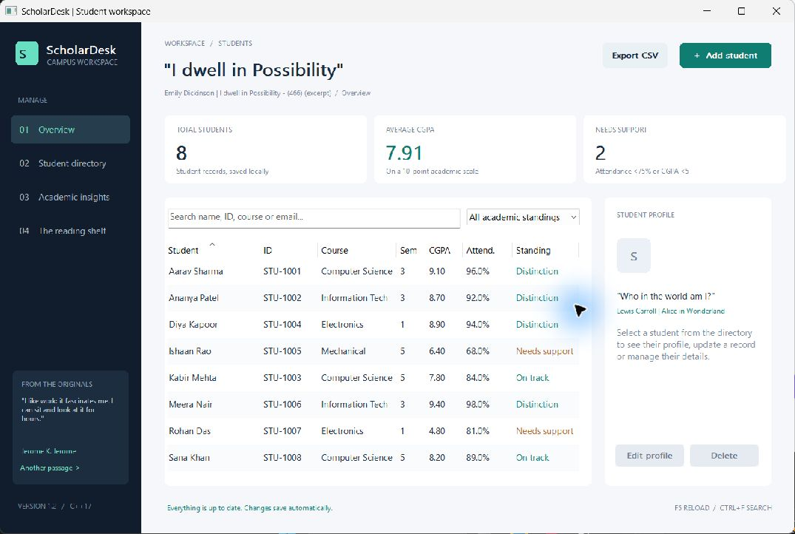
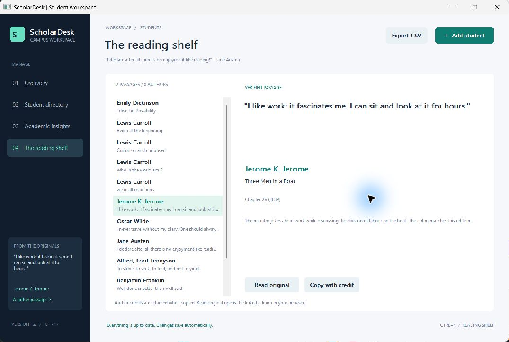

# ScholarDesk 1.2

[](LICENSE)
[](https://github.com/harshshodey/scholardesk/actions/workflows/ci.yml)

A complete C++17 student management system for a practical OOP project. A native Windows desktop app combines a navy sidebar, mint accents, live dashboard cards, a searchable directory and student profiles. A colourful console edition is also included for presenting the core C++ concepts. Both interfaces use the same classes, vector and file storage. No third-party libraries or database server are needed.

## Start in one click on Windows

1. Download the Windows ZIP from the [latest release](https://github.com/harshshodey/scholardesk/releases/latest) and extract the complete project folder.
2. Double-click **Run ScholarDesk.cmd**.
3. Choose an option from the dashboard.

The release ZIP includes `bin/ScholarDesk.exe`, a ready-to-run, statically linked Windows x64 desktop executable. Binaries are not checked into the source repository. If you cloned or downloaded the source, build it first using the instructions below. A display of at least 1280 × 900 logical pixels is recommended. The interface resizes with the window.



For the console edition, double-click **Run Console.cmd**. Use Windows Terminal, a dark background, a monospace font such as Cascadia Code, and a window at least **100 columns by 34 rows** for the best appearance. Legacy terminals fall back to plain text when ANSI colours are unavailable.

Eight fictional students are included so you can demonstrate every feature immediately. Changes persist between launches. All email addresses use example.com.

## What you can do

### Desktop edition

- **Overview:** live student totals, average CGPA and number needing support.
- **Student directory:** type in the search box to match a name, ID, course or email immediately. Use the academic-standing dropdown to narrow the results, including On track. Click a column heading to sort; click again to reverse it. Numeric columns sort by value. Your selected student stays selected after sorting.
- **Student profile:** select a row to see the full profile. Double-click a row or use **Edit profile** to open the edit form. Long table values have native hover tips.
- **Add student:** enter all seven fields and press **Save student**. Invalid input preserves the form and focuses the field to correct. Saving clears filters and selects your new student so the record is immediately visible.
- **Delete:** select a row and press **Delete**. The confirmation defaults to keeping the record. **Undo delete** restores the most recently deleted student until you close the application or delete another record. The previous data revision is also backed up on disk.
- **Academic insights:** view attendance, distinction counts and a course-distribution chart. The chart shows the courses that fit the window, ordered by student count, with a total course count below.
- **Export CSV:** save a timestamped file in `exports/`. A message shows its full location.
- **Reading shelf:** explore 12 sourced, human-authored literary passages from eight authors. Read the context, copy a passage with its author/work/link, or open the original edition. The sidebar's **Another passage** button cycles through them without changing student records.

Short quotations are also used in headings, form introductions, no-results guidance and export confirmation. The app remains fully usable offline. See [LITERARY_SOURCES.md](LITERARY_SOURCES.md) for every exact passage, its location, attribution and context. These decorative lines come from historical human writing; operational labels and messages remain direct instructions.



Use Tab to move between controls, including sidebar navigation. Closing a changed form asks before discarding edits; choose No to keep editing. Desktop records save as soon as **Save student** succeeds.

| Shortcut | Action |
|---|---|
| Ctrl+F | Open directory and focus search |
| Ctrl+N | Add student |
| Ctrl+E | Edit selected student |
| Ctrl+S | Export CSV in the main window; save in a student form |
| Ctrl+1 / Ctrl+2 / Ctrl+3 / Ctrl+4 | Overview / Directory / Insights / Reading shelf |
| F5 | Reload records saved by another window or program |
| Escape | Clear search/filter in the directory; request form cancellation |
| Enter | Save a form, or edit the selected row when the table has focus |
| Delete | Request deletion when the table has focus |
| Ctrl+A | Select all text in an input field |

Empty searches show guidance rather than an unexplained blank table. Academic export remains available on the insights page.

### Console edition

| Option | Behaviour |
|---|---|
| 1 — Student directory | Alphabetical, paginated table with CGPA, attendance and standing |
| 2 — Add a student | Validated form, unique ID check, full preview before saving |
| 3 — Find a student | Case-insensitive partial search by ID, name, course or email; full record details |
| 4 — Update a student | Keep existing fields with Enter; preview and confirm edits |
| 5 — Delete a student | Preview the record and type its exact ID to confirm |
| 6 — Academic insights | Average CGPA, attendance, support counts and course distribution |
| 7 — Export to CSV | Spreadsheet-friendly export with quoted fields and formula protection |
| 8 — Reload directory | Reload saved records, including changes from another window |
| 9 — Reading shelf | Select a literary passage to see its author, work, context and original link |
| 0 — Save & exit | Exit cleanly; completed changes are already saved |

Type `/cancel` at any prompt to return to the dashboard. EOF (Ctrl+Z then Enter on Windows, Ctrl+D on Unix) exits cleanly without committing an incomplete form. New records and edits require `y` at the save prompt.

## Build from source

You need a C++17 compiler, such as MinGW-w64 GCC or Clang, or Visual Studio with CMake. The desktop edition additionally uses the Windows SDK APIs. A compiler is only needed to rebuild the source.

**Windows PowerShell with g++ in PATH**

```powershell
./build.ps1
./test.ps1
# For the requested three complete regression passes:
./test.ps1 -Repeat 3
./'Run ScholarDesk.cmd'
```

If local PowerShell policy blocks the scripts, run the following direct compiler commands from the project folder:

```powershell
g++ -std=c++17 -O2 -Wall -Wextra -Wpedantic -static -I include src/main.cpp src/console.cpp src/registry.cpp -o bin/ScholarDeskConsole.exe
windres app.rc -o bin/app-resource.o
g++ -std=c++17 -O2 -Wall -Wextra -Wpedantic -static -municode -mwindows -I include src/desktop.cpp src/registry.cpp bin/app-resource.o -lcomctl32 -lgdi32 -lshell32 -o bin/ScholarDesk.exe
g++ -std=c++17 -O2 -Wall -Wextra -Wpedantic -static -I include tests/registry_tests.cpp src/registry.cpp -o bin/scholar_tests.exe
./bin/scholar_tests.exe
```

**CMake on Windows, Linux or macOS**

```sh
cmake -S . -B build
cmake --build build --config Release
ctest --test-dir build -C Release --output-on-failure
```

Run `./build/ScholarDesk` (console) on Linux/macOS. On Windows, a Visual Studio generator puts the desktop at `./build/Release/ScholarDesk.exe` and the console at `./build/Release/ScholarDeskConsole.exe`. A single-configuration Windows generator puts them directly inside `build/`. Run the console from the project root so it finds the sample data. The desktop locates the project data relative to the executable automatically.

## Data and recovery

- Default file: `data/students.sdb`. The console resolves it relative to the working directory. The desktop locates the project folder above its executable. The launchers select the project directory first.
- Each successful modification writes a complete replacement to `.tmp`, checks stream errors, backs up the previous data to `.bak`, then replaces the active file. The in-memory vector changes only after the replacement succeeds.
- `data/students.sdb.bak` holds **one previous revision**, not a permanent history. If recovery is necessary, close the application, preserve a copy of the current file, then copy the `.bak` file over `students.sdb`. Start the application again to validate it.
- Malformed records, invalid values and duplicate IDs stop startup with an error rather than silently discarding data.
- CSV exports go to `exports/` beside the data directory. Exports are completed in a temporary file before publication; existing exports are never overwritten. Custom data paths place exports relative to the data directory's parent.
- A short-lived OS lock prevents simultaneous writes by cooperating app instances. Before saving, the app compares the file with the version it loaded. If another window or program changed it, saving is blocked rather than overwriting those changes. Reload with F5 (desktop) or option 8 (console), then retry your operation. Unsaved form values stay in the form after a failed save; copy them before closing it to reload.
- `.lock` files may remain beside data and exports. The OS releases the actual lock automatically when the operation finishes or the process exits; the file's existence does not mean the app is still locked.
- This is an educational local application without accounts, encryption or automatic merging of simultaneous edits. Reload before making further changes in a second window.
- Text inputs accept printable English/ASCII characters. ID: 1–16 letters/digits/`-`/`_`; name: 1–60 characters; course: 1–40; semester: 1–12; CGPA: 0–10; attendance: 0–100. Email validation checks basic structure, not mailbox existence.

Start with an empty directory without changing the sample data:

```powershell
./bin/ScholarDeskConsole.exe --data data/my-students.sdb
```

Console options: use `--no-color` or the `NO_COLOR` environment variable for plain output. `--help` displays command-line usage. Desktop options are controlled through its interface.

## Project structure

```text
ScholarDesk/
  include/student.hpp       Student class, constructors, getters, validation
  include/registry.hpp      Registry class and CRUD interface
  include/console.hpp       Console interface declaration
  include/literature.hpp    Shared sourced quotations and attribution catalogue
  src/registry.cpp          Vector operations, search, persistence and CSV export
  src/console.cpp           Dashboard, tables, forms and insights
  src/main.cpp              App startup, command-line arguments, terminal setup
  src/desktop.cpp           Native Windows UI, forms, dashboard and chart
  tests/registry_tests.cpp  Behavioural tests using isolated temporary data
  tests/desktop_tests.inc   Real desktop-control and modal-form integration checks
  tests/console_smoke.ps1   End-to-end console workflows
  data/students.sdb         Fictional sample records
  bin/ScholarDesk.exe       Ready-to-run Windows desktop build
  bin/ScholarDeskConsole.exe Ready-to-run Windows console build
  app.manifest / app.rc     Native Windows visual styles
  CMakeLists.txt            Cross-platform build and test configuration
  build.ps1 / test.ps1      Simple Windows build and test scripts
  Run ScholarDesk.cmd      Double-click launcher
  Run Console.cmd          Console launcher for practical demonstrations
  PROJECT_GUIDE.md          Concepts, algorithms, practice tasks and viva notes
  CHANGELOG.md              Fixes and usability improvements in version 1.1
  VALIDATION.md             Test results and verification scope
  LITERARY_SOURCES.md        Exact quotations, original sources and placement notes
```

The academic standing rules are demonstration rules: support if attendance is below 75% or CGPA is below 5; otherwise distinction at CGPA 8.5 or higher; otherwise on track. They are not an institutional grading policy.

## Open source

Created by [Harsh](https://github.com/harshshodey). Original source code and original documentation are available under the [MIT License](LICENSE). Literary excerpts keep their author credits and applicable third-party rights; see [THIRD_PARTY_NOTICES.md](THIRD_PARTY_NOTICES.md) and [LITERARY_SOURCES.md](LITERARY_SOURCES.md).

Contributions are welcome. See [CONTRIBUTING.md](CONTRIBUTING.md) for build instructions, test guidance and pull-request expectations.
